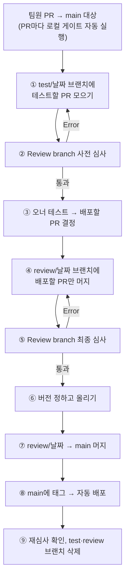
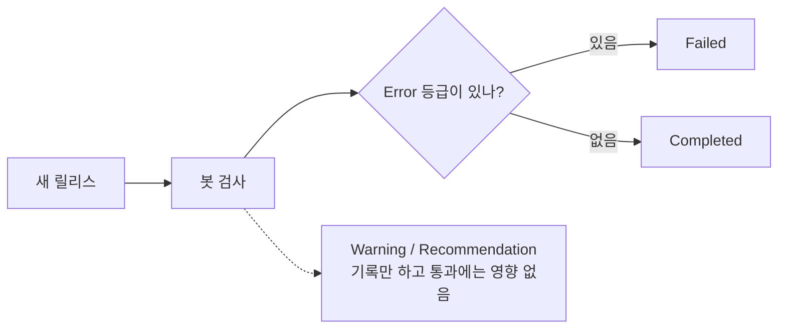
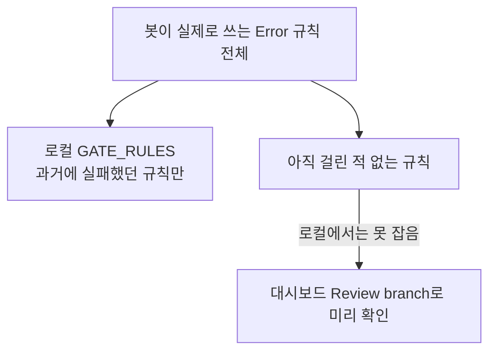

# Obsidian 커뮤니티 심사와 릴리스 안내 (한국어)

CMDS Achmage를 새 버전으로 배포할 때 Obsidian 커뮤니티 심사를 어떻게 통과하는지 정리한 문서입니다.
영어 원문 [obsidian-community-review.md](obsidian-community-review.md)를 한국어 사용자가 읽기 쉽게 다시 썼습니다.
명령어와 규칙 이름이 서로 다르면 영어 원문을 따릅니다.

## 한눈에 보기

**배포는 공식 심사(Review branch)를 통과한 뒤에만 합니다.** 공식 심사는 두 번 돌립니다. 오너 테스트 전에 테스트 브랜치로 한 번(사전 심사), 배포할 PR만 모은 리뷰 브랜치로 한 번(최종 심사)입니다. 버전 번호는 최종 심사를 통과한 다음에 정합니다 (2026-10-21 오너 결정).



## 1. 심사는 어떻게 이루어지나

- 플러그인은 [`obsidianmd/obsidian-releases`](https://github.com/obsidianmd/obsidian-releases)에 등록되어 있습니다.
  여기서 봇이 [`eslint-plugin-obsidianmd`](https://www.npmjs.com/package/eslint-plugin-obsidianmd) 검사와
  빌드 재현 검사를 돌리고, 그다음에 사람이 검토합니다.
- **새 릴리스를 배포하면 따로 요청하지 않아도 봇이 자동으로 다시 심사합니다.**
  결과는 커뮤니티 대시보드(`community.obsidian.md/account/plugins/cmds-achmage`)의 Reviews 항목에 나옵니다.
- 지적 사항은 **Error / Warning / Recommendation** 세 등급으로 나뉩니다.
  **자동 심사를 실패시키는 건 Error 등급뿐입니다.**
  Warning과 Recommendation은 자동 심사를 막지 않지만, 사람이 검토할 때 언급할 수는 있습니다.



### 심사에 실패하면 생기는 일 (1.3.1 사례)

최신 릴리스가 Failed를 받으면 **Obsidian 앱의 커뮤니티 플러그인 검색에서 빠질 수 있습니다.**

- 1.3.1은 2026-10-15 00:34 UTC에 배포됐고, 자동 심사에서 Failed를 받았습니다.
- 같은 날 12:39 UTC에 올라온 `community-plugins.json` 갱신 커밋부터 `cmds-achmage`가 목록에서 빠졌습니다.
- 1.3.2에서 문제를 고쳐 심사를 통과했습니다.

"실패하면 목록에서 내린다"는 규칙은 Obsidian이 문서로 밝힌 내용이 아니라, 시점이 맞아떨어져서 내린 **추정**입니다.
그래도 이 추정을 기준으로 움직이는 편이 안전합니다. **배포한 뒤 하루 안에 대시보드에서 심사 결과를 꼭 확인하세요.**

## 2. 실제로 심사를 실패시킨 규칙

지금까지 Error로 걸렸던 항목과 해결 방법입니다.

| 걸린 내용 | 해결 방법 |
| --- | --- |
| 이유를 적지 않은 `eslint-disable` 주석 | 주석 끝에 `-- <이유>`를 붙인다 |
| `@typescript-eslint/no-explicit-any`를 끄는 주석 | 허용되지 않음. 끄지 말고 값에 타입을 지정한다 |
| iOS가 지원하지 않는 lookbehind 정규식 `(?<=…)` | lookbehind 없이 다시 쓴다 (모바일, iOS 16.4 미만) |
| 스타일 직접 대입 (`el.style.x = …`) | `el.setCssStyles({ … })`를 쓴다 |
| `<style>` 요소를 만드는 코드 (1.3.1) | CSS를 `styles.css`로 옮기고, UI를 Obsidian이 스타일시트를 불러오는 문서 안에 둔다 |
| 설정 화면의 `<h2>` 제목 | `new Setting(el).setName(…).setHeading()`을 쓴다 |
| 설정 제목에 "settings"나 플러그인 이름이 들어감 | 제목을 바꾼다 (예: "Could not load") |

> **주의:** 한 가지를 고치다가 다른 규칙에 새로 걸릴 수 있습니다.
> 1.0.1에서 `<h2>`를 `.setHeading()`으로 바꿨더니, 그 제목이 "제목에 settings/플러그인 이름 금지" 규칙의 검사 대상이 되어
> 다음 릴리스가 실패했습니다. 그래서 배포 전에 아래의 로컬 검사를 꼭 돌려야 합니다.

### 심사를 막지 않는 항목

아래 항목은 Warning이나 Recommendation으로만 나오고 자동 심사를 실패시키지 않습니다.
품질 개선 과제로 관리하면 되고, 배포를 미룰 이유는 아닙니다.

- `@typescript-eslint/*`의 타입 기반 규칙 전부 (처리하지 않은 Promise, `no-unsafe-*` 등)
- 팝아웃 창 호환성 규칙 (`prefer-window-timers`, `no-global-this`)
- `prefer-create-el`, `no-console`, `no-default-hotkeys`, `prefer-setting-definitions`
- `main.js`가 5MB를 넘는 경우, 의존성 보안 권고, CSS 린트

## 3. 로컬 게이트 (PR마다 자동 실행)

`eslint-plugin-obsidianmd`는 ESLint 9가 필요한데, 이 저장소는 ESLint 8을 씁니다.
그래서 심사용 도구는 `tools/obsidian-review/`에 따로 두었습니다. 이 폴더에는 별도의 `package.json`, 잠금 파일, ESLint 9 설정이 있습니다.
**저장소 최상위 폴더에서** 실행하세요. CI의 `Obsidian community review gate`도 같은 명령을 씁니다.

```bash
npm --prefix tools/obsidian-review ci   # 처음 한 번, 또는 도구를 바꾼 뒤
node tools/obsidian-review/check.mjs    # 심사 게이트
```

- 아무것도 출력하지 않고 끝나면 통과입니다.
- Error 등급 항목이 있거나 도구가 제대로 실행되지 않으면 실패 코드로 끝납니다.

### 로컬 게이트의 한계

로컬 게이트는 **지금까지 실제로 실패했던 규칙만** 골라서 검사합니다.
설정 파일은 `tools/obsidian-review/eslint.config.mjs`이고, 검사하는 규칙은 `GATE_RULES`에 들어 있습니다.

- `eslint-comments/require-description`, `eslint-comments/no-restricted-disable`, `eslint-comments/no-unlimited-disable`
- `obsidianmd/regex-lookbehind`, `obsidianmd/no-static-styles-assignment`
- `obsidianmd/no-forbidden-elements` (1.3.1 이후 추가)
- `obsidianmd/settings-tab/no-manual-html-headings`, `obsidianmd/settings-tab/no-problematic-settings-headings`

그래서 **처음 걸리는 규칙은 로컬 게이트가 잡지 못합니다.** 로컬 게이트는 이미 겪은 실수가 다시 들어오는 걸 PR 단계에서 막는 보조 장치이고, 배포 통과 여부는 5장의 공식 심사(Review branch)로 판정합니다. 1.3.1이 바로 그런 경우였습니다.
`no-forbidden-elements`가 목록에 없어서 CI는 통과했지만, 실제 심사에서는 실패했습니다.



이 빈틈은 이렇게 메웁니다.

1. **배포 전에 대시보드의 "Review branch"로 공식 심사를 받습니다.** 릴리스 절차의 필수 단계입니다 (5장).
2. 새로운 Error 규칙에 걸렸다면 그 규칙 ID를 `GATE_RULES`에 추가해서 다음부터는 로컬에서 잡히게 합니다.
3. Warning까지 포함한 전체 결과를 보고 싶으면 `eslint-plugin-obsidianmd`의 `recommended` 설정으로 `src`를 직접 검사합니다.

## 4. 사람 검토자가 물어볼 수 있는 기능

심사 보고서의 **Behavior** 항목에는 봇이 완전히 분석하지 못하는 기능이 표시됩니다.
이 플러그인에서는 모두 정상적인 용도이며, 질문을 받으면 아래처럼 설명하면 됩니다.

- **셸 실행:** Plan 기능(`src/core/llm/native/`)이 구독형 CLI를 실행합니다.
  데스크톱에서만 동작하고(`requireNode`, `isDesktopOnly: true`), 사용자가 직접 켜야 동작합니다.
- **파일 시스템 직접 접근:** 위 네이티브 런타임의 경로 처리용이며, 역시 데스크톱 전용입니다.
- **동적 코드 실행 (`eval` / `new Function`):** **우리 코드가 아닙니다.**
  간접 의존성인 `ajv`가 JSON 스키마를 컴파일할 때 `new Function`을 씁니다.

## 5. 릴리스 절차

**원칙:** 공식 심사(Review branch)를 통과한 것만 `main`에 머지하고 배포합니다. 공식 심사는 사전 심사(테스트 브랜치)와 최종 심사(리뷰 브랜치) 두 번입니다. 버전 번호는 최종 심사를 통과한 뒤에 정합니다.
로컬 게이트는 PR마다 자동으로 도는 보조 장치이고, 배포 여부를 판정하지 않습니다.

**브랜치 세 가지** (팀원 PR은 항상 `main`을 대상으로 올리고, 7번에서 `main`에 머지될 때까지 열린 상태로 둡니다)

| 브랜치 | 용도 | 들어가는 것 |
| --- | --- | --- |
| `test/YYYY-MM-DD` | 사전 심사, 오너 테스트 | 써 보고 싶은 PR 전부 |
| `review/YYYY-MM-DD` | 최종 심사 | 배포하기로 정한 PR만 |
| `main` | 배포 | 심사를 통과한 리뷰 브랜치 + 버전 변경 |

준비 사항: `gh auth switch`로 `cmds-contact` 계정으로 바꾸고, 커밋 작성자는 `CMDSPACE <cmdspace.contact@gmail.com>`으로 합니다.

1. **테스트할 PR을 `test/YYYY-MM-DD`에 모읍니다.** 최신 `main`에서 만들고, `main`에는 머지하지 않습니다.
   ```bash
   git switch main && git pull
   git switch -c test/YYYY-MM-DD
   git merge origin/<PR 브랜치1> origin/<PR 브랜치2> …
   git push -u origin test/YYYY-MM-DD
   ```
   줄줄이 쌓인 PR 묶음은 맨 위 PR의 브랜치 하나만 머지하면 됩니다.
2. **사전 심사:** 커뮤니티 대시보드에서 **Review branch**를 누르고 `test/YYYY-MM-DD`를 고릅니다.
   오너가 테스트에 시간을 쓰기 전에 심사 Error를 미리 찾는 단계입니다.
   Error가 나오면 해당 PR 작성자에게 PR 브랜치에서 고쳐 달라고 요청하고, 고친 브랜치를 테스트 브랜치에 다시 머지합니다.
3. **오너가 직접 테스트하고, 배포할 PR을 정합니다.**
   ```bash
   npm ci && npm run build
   ```
   `main.js`, `manifest.json`, `styles.css`를 테스트 볼트의 `.obsidian/plugins/cmds-achmage/`에 복사합니다.
   이번에 빠진 PR은 열린 채로 두고 다음 차례에 다시 테스트합니다.
4. **최신 `main`에서 `review/YYYY-MM-DD`를 만들고, 배포할 PR만 머지합니다.** 테스트 브랜치가 아니라 각 PR의 브랜치에서 머지합니다.
   ```bash
   git switch main && git pull
   git switch -c review/YYYY-MM-DD
   git merge origin/<배포할 PR 브랜치> …
   git push -u origin review/YYYY-MM-DD
   ```
   `main.js`와 `meta.json`은 커밋하지 않습니다. 릴리스 워크플로가 다시 빌드합니다.
5. **최종 심사:** 커뮤니티 대시보드에서 **Review branch**를 누르고 `review/YYYY-MM-DD`를 고릅니다.
   Error가 나오면 고치는 PR을 리뷰 브랜치 대상으로 올려 머지하고 다시 심사합니다.
6. **최종 심사를 통과하면 버전을 정하고 리뷰 브랜치에서 올립니다** (커밋 하나, 별도 PR 필요 없음).
   ```bash
   node scripts/version-bump.mjs X.Y.Z
   node scripts/check-version-parity.mjs X.Y.Z
   ```
   `docs/releases/RELEASE_NOTES_X.Y.Z.md`를 쓰고 README·가이드의 버전 링크도 고칩니다. 메타데이터와 문서만 바뀌므로 심사를 다시 받지 않아도 됩니다.
7. **`review/YYYY-MM-DD` → `main` PR을 만들어 머지합니다.** 머지 방식은 반드시 **Create a merge commit**입니다(Squash 금지).
   그래야 포함된 PR들이 GitHub에서 Merged로 표시되고 작성자 기록이 남습니다.
   4번 이후 `main`이 바뀌었다면 `main`을 리뷰 브랜치에 먼저 받아 오고 5번을 다시 합니다.
8. **`main`에 annotated 태그를 달고 push합니다.** GitHub 웹 화면에서 만든 태그는 일반 태그라서 워크플로가 거부하니, 반드시 명령어로 만듭니다.
   ```bash
   git switch main && git pull
   git tag -a X.Y.Z -m "CMDS Achmage X.Y.Z"
   git push origin refs/tags/X.Y.Z
   ```
   태그는 `origin/main` HEAD를 가리켜야 합니다. **7번과 8번 사이에는 `main`에 아무것도 머지하지 않습니다.**
9. **나머지는 릴리스 워크플로가 처리합니다.** `.github/workflows/release.yml`이 전체 CI, 빌드, 출처 증명(attestation), 파일 검증, 공개를 차례로 합니다.
10. **배포 후 대시보드에서 재심사 결과를 확인하고, test·review 브랜치를 지웁니다.**
   Pending이 하루 넘게 바뀌지 않으면 **Check for new releases**를 누릅니다.

**왜 `main`을 거쳐야 하나:** Obsidian은 기본 브랜치(`main`) HEAD의 `manifest.json`을 읽고, `release.yml`은 태그가 `main` HEAD와 같아야 배포합니다.

## 6. 버전별 심사 이력

| 버전 | 결과 | 내용 |
| --- | --- | --- |
| 1.0.0 | 실패 | README가 한국어로만 되어 있었고, `isDesktopOnly` 값이 틀렸고, `obsidianmd` Error가 많았고, 출처 증명이 없었음 |
| 1.0.1 | 실패 | 영어 README 추가, `isDesktopOnly: true`로 수정, 여러 Error 해결, 출처 증명 추가. 그런데 `<h2>`를 `.setHeading()`으로 바꾸면서 설정 제목 규칙에 새로 걸림 |
| 1.0.2 | **통과** | 오류 화면 제목을 "Could not load"로 변경 |
| 1.3.1 | 실패 | 인라인 편집 UI가 Shadow DOM 안에서 `<style>` 요소를 만듦 (`obsidianmd/no-forbidden-elements`). **커뮤니티 검색 목록에서 빠짐** |
| 1.3.2 | **통과** | 인라인 편집 스타일을 `styles.css`로 옮김 (#64) |

## 참고 자료

- Obsidian 플러그인 가이드라인: <https://docs.obsidian.md/Plugins/Releasing/Plugin+guidelines>
- 플러그인 제출 방법: <https://docs.obsidian.md/Plugins/Releasing/Submit+your+plugin>
- `eslint-plugin-obsidianmd`: <https://www.npmjs.com/package/eslint-plugin-obsidianmd>
- 품질 개선 과제: 이슈 #14–#21
- 1.3.1 실패 조사 기록: `docs/research/R-057-inline-style-review.md`
